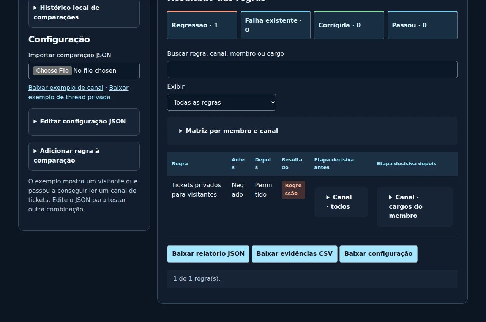

# Porta Fechada

**Experimente em um minuto.** Na demo, expanda a etapa decisiva no exemplo de tickets. Abra as etapas de antes e depois para conferir qual regra liberou o acesso. Há também um exemplo de thread privada para importar.

[Abrir demonstração](https://ykauttiz.github.io/porta-fechada/) · [Portfólio do Kauê](https://ykauttiz.github.io/contratempo/portfolio/)

Um visitante deve ficar fora do canal de tickets. Uma mudança de cargo passou a permitir a leitura. Abra **index.html** para ver a regra quebrar e a coluna que mudou de “Negado” para “Permitido”.

Baixe a pasta para usar offline. O editor aceita o formato de **exemplo.json**. Os objetos `before` e `after` descrevem o cargo geral, os cargos adicionais e as sobrescritas de cada canal. Cada regra identifica membro, cargos, canal, permissão e resultado esperado. Máscaras são strings decimais. O verificador lê exclusivamente o documento fornecido.

O cálculo combina permissões do servidor, aplica a sobrescrita geral, agrega as dos cargos e aplica a do membro por último. Dono e administrador têm acesso. Enviar mensagens requer visibilidade do canal. O simulador cobre canais de texto e threads públicas e privadas. Use as sobrescritas efetivas do canal pai. Timeout, canais de voz e hierarquia de moderação ficam fora do modelo.

### Testar uma thread privada

Baixe [o exemplo de convite](exemplo-thread.json) e abra o arquivo em **Importar comparação JSON**, ou execute `node check.js exemplo-thread.json`. Antes do convite, o participante não consegue responder. Depois, a regra aparece como **Corrigida**. Para testar a mesma pessoa em outro canal, altere o destino da regra.

No formato 2, cada entrada em `threads` declara o canal pai, o tipo, os membros convidados e os estados `locked` e `archived`. A regra de envio considera o envio imediato. Uma thread arquivada desbloqueada pode reabrir ao enviar. Para uma bloqueada e arquivada, simule a reabertura explícita antes de testar o envio. O simulador usa somente o cenário informado. [Referência do Discord](https://docs.discord.com/developers/topics/threads)

Node 20+ · `node --test`. Os testes cobrem o exemplo, precedência do membro, administrador e configurações inválidas.

[Referência de permissões do Discord](https://discord.com/developers/docs/topics/permissions)

## Aparência e navegação

No cabeçalho, escolha **Sistema**, **Claro** ou **Escuro**. Sistema acompanha o aparelho. O navegador guarda a escolha localmente para a próxima visita. Use Tab para chegar ao atalho de conteúdo e aos controles. As transições respeitam a preferência de movimento reduzido.

## Usar em um pipeline

Execute `node check.js exemplo.json --json`. O relatório vai para a saída padrão. O código de saída é **0** quando todas as regras passam no estado final, **1** quando alguma falha e **2** para arquivo ausente, JSON inválido ou configuração incompatível. O exemplo incluído termina com **1** porque contém uma regressão intencional. Omita `--json` para ler o resultado por linha.

## Origem da decisão

A tabela mostra a última etapa que alterou o acesso efetivo no cenário final. No JSON do terminal, os campos beforeReason e afterReason mostram as etapas para os dois cenários. Uma sobrescrita redundante não altera a explicação.

## Comparar configurações locais

Carregue o exemplo, importe um JSON ou abra o editor. No formulário de regras, informe o canal, o membro, seus cargos, a operação e o resultado esperado. O painel mostra as etapas decisivas antes e depois da mudança. Filtre regressões para investigar e baixe a configuração para repetir a análise ou o relatório para consultá-lo depois. O relatório inclui todas as regras avaliadas.

O formato reconhece as versões 1 e 2 e os arquivos antigos sem versão. As máscaras são strings decimais. Sobrescritas repetidas, cargos desconhecidos e bits simultaneamente permitidos e negados são recusados mesmo em canais que não aparecem nas regras. O limite é de 2 MiB por arquivo e 2 mil regras. A simulação usa dados fornecidos localmente, sem conexão com o servidor Discord.

[Referência de permissões do Discord](https://docs.discord.com/developers/topics/permissions)

O relatório CSV contém todas as regras avaliadas, os cargos, a expectativa, as decisões e as etapas decisivas. No terminal, use `node check.js exemplo.json --csv > evidencias.csv`. O relatório do navegador e o CSV do terminal incluem o SHA-256 do JSON compacto em UTF-8, útil para comparar a entrada usada nas duas análises. A ordem das propriedades faz parte do cálculo.

Campos exportados neutralizam prefixos de fórmula ASCII, caracteres de controle e variantes Unicode conhecidas antes que o arquivo seja aberto em uma planilha.

Busque regras por nome, canal, membro ou cargo e combine a busca com o filtro de resultado. Os downloads continuam representando a comparação completa. Uma importação inválida identifica qual configuração continua em uso.

O painel de resultados conta os quatro tipos de decisão dentro da busca atual. Selecione um contador para filtrar e selecione-o novamente para remover o filtro. A tabela apresenta 50 regras por página, e CSV e JSON incluem a análise completa.

O CI executa os testes do motor e da CLI com cobertura no Node 22 e 24. Abra a etapa de testes para consultar as linhas e ramos cobertos.

[Ver testes e capturas de celular e computador](https://github.com/ykauttiz/porta-fechada/actions/workflows/verificar.yml). Na execução, abra o artefato **capturas-chromium** ou **capturas-firefox**. As imagens usam dados fictícios.

A matriz por membro mostra leitura e envio antes e depois, separados por canal e conjunto de cargos declarado. Uma operação sem regra aparece explicitamente como tal.

Histórico de comparações nomeadas no navegador, com reabertura, validação e remoção pela interface. O download da configuração permite manter uma cópia fora do navegador.

## Privacidade, segurança e contribuição

A análise roda no navegador ou no terminal sobre o JSON que você fornece, sem conexão com o servidor do Discord. O histórico de comparações fica no armazenamento local do navegador. Um snapshot real pode conter IDs de cargos, canais e membros: anonimize-o antes de compartilhar.

Para relatar uma falha, veja [SECURITY.md](SECURITY.md). Para propor mudanças, veja [CONTRIBUTING.md](CONTRIBUTING.md). Use somente dados fictícios ou anonimizados em issues e pull requests.

## Publicar uma versão

Atualize `RELEASE.md` com as mudanças verificadas. Para marcar uma entrega, use na branch principal um commit com o título `release(vAAAA.MM.DD) Título da atualização`. Para uma segunda edição no mesmo dia, acrescente um número à versão, como `vAAAA.MM.DD.1`. O GitHub Actions publica a release após a aprovação dos testes. Commits comuns continuam atualizando o site.
